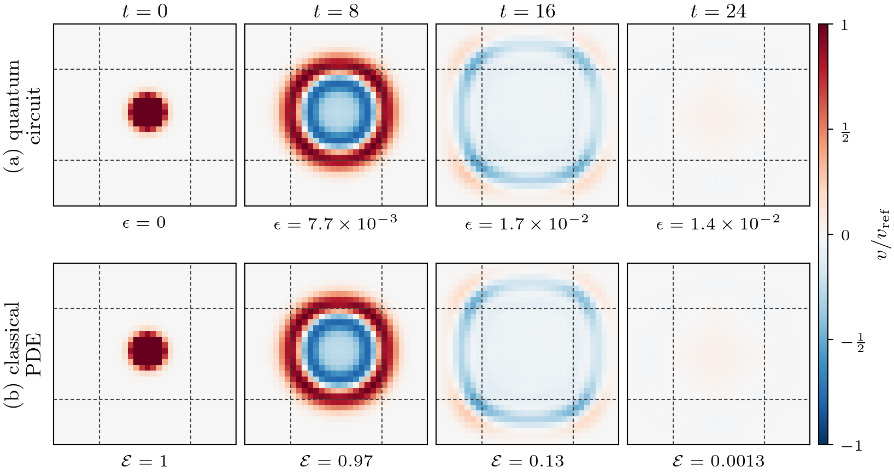
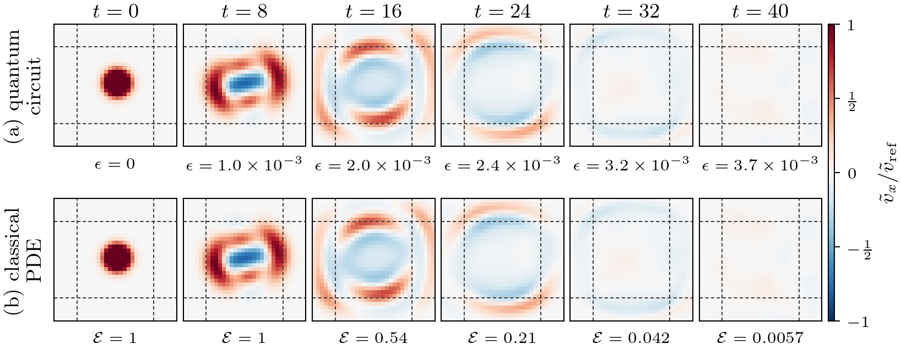
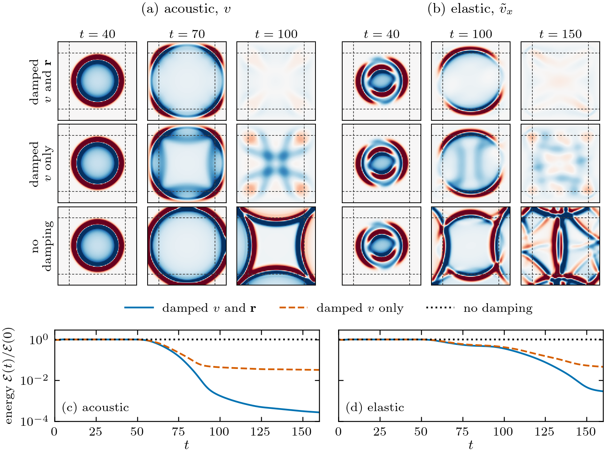
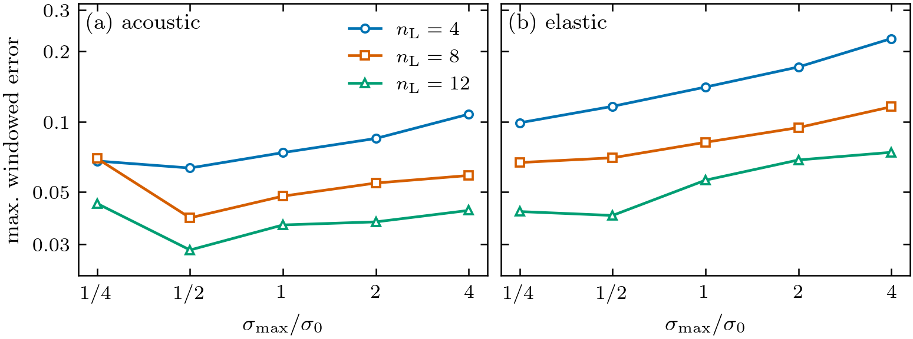
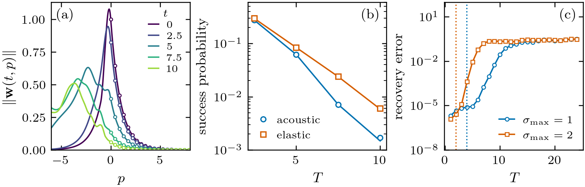
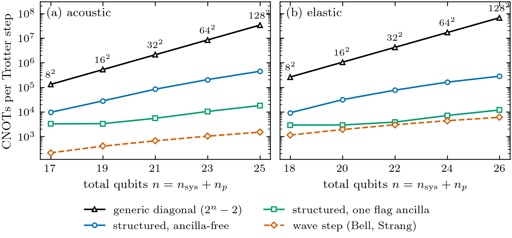

# Sponge layers for quantum simulation of acoustic and elastic waves

Code and data for the paper *Quantum simulation of dissipative acoustic and
elastic waves by Schrödingerisation: absorbing boundaries and explicit
polynomial-size circuits* (H. A. Nguyen and
A. Tura, Colorado School of Mines).

The damped wave equations (sponge absorbing layer) are written as
`dψ/dt = (-iH - Σ) ψ`, Schrödingerised with one auxiliary variable `p`, and
compiled into explicit circuits. The damping factor of each Trotter step,
`exp(iτ D_η ⊗ Σ)`, is compiled exactly with a number of gates polynomial in the
qubit count (`lib/structured_damping.py`).

## Layout

| path | content |
|---|---|
| `lib/op_library.py`, `lib/evolution.py` | difference operators as qubit strings; Bell-basis term circuits, Strang splitting |
| `lib/absorbing.py` | damping profile `pml_sigma_profile`, acoustic sponge `WaveEquationSponge2d` |
| `lib/sponge1d.py` | one-dimensional acoustic sponge |
| `lib/elastic.py`, `lib/elastic_separated.py` | symmetrised velocity–stress encoding of the isotropic elastic equations |
| `lib/elastic_sponge.py` | elastic sponge `ElasticSponge2d` |
| `lib/schrodingerisation.py` | warped transform, Fourier modes in `p`, recovery, Qiskit circuits |
| `lib/structured_damping.py` | polynomial-size damping circuit (ancilla-free and one-flag-ancilla variants) |
| `tests/` | unit tests (`pytest -q tests`, 50 tests) |
| `paper/experiments/` | one script per result; each writes a `*_results.json` (and `*.npz` fields) |
| `figures/` | paper figures (PDF and PNG) and plotted field data |

## Figures

**Gate-level runs.** Absorbed acoustic wave, $32\times32$ grid, 21 qubits
(top: recovered from the quantum circuit; bottom: classical solution of the
damped PDE; dashed lines mark the sponge layers):



Absorbed elastic wave ($\tilde v_x$), $32\times32$ grid, 25 qubits, structured damping circuit:



**Classical check of the sponge** (independent leapfrog solver): damping both
fields absorbs, damping the velocity only leaves a remnant, no damping reflects:



**Absorption quality** versus damping amplitude and layer width:



**The warped variable $p$**: profile, success probability and truncation error:



**Circuit cost**: CNOTs per Trotter step, generic diagonal versus the structured damping circuit:



## Environment (uv, no pip or conda needed)

Install [uv](https://docs.astral.sh/uv/) once:

```
curl -LsSf https://astral.sh/uv/install.sh | sh      # macOS / Linux
```

Then, from this folder, `uv run` creates the environment from `uv.lock`
(Python 3.12, qiskit 1.4.5, qiskit-aer 0.16.4, numpy, scipy, matplotlib),
downloading Python itself if needed, and runs the command:

```
uv run pytest -q                                      # 50 tests
uv run python paper/experiments/sponge_absorption.py  # any experiment
```

Figures use a LaTeX installation for text rendering. `requirements.txt` is
kept for users who prefer pip.

qiskit is pinned to 1.4.5. With the flag-ancilla damping circuit, simulate
with Aer at `optimization_level=0`. To transpile a damping circuit on its
own, pass `qubits_initially_zero=False`; CNOT counts in the paper are sums
of per-gate syntheses (`cx_count_per_gate`, see Appendix C of the paper).

## Reproducing the results

Run from this folder. Most scripts use 8 worker processes.

| result in the paper | script | output |
|---|---|---|
| Fig. FD comparison (classical leapfrog check) | `sponge_fd_comparison.py` | `sponge_fd_comparison_results.json` |
| Fig. absorption sweep | `sponge_absorption.py` | `sponge_absorption_results.json` |
| Fig. p-space (warped variable, success probability, truncation) | `pspace_analysis.py` | `pspace_analysis_results.json` |
| Fig. 21-qubit acoustic gate-level run | `acoustic_gate_32x32.py`, then `acoustic_fig_gate32.py` | `figures/fig6_data.npz` |
| Fig. 25-qubit elastic gate-level run | `elastic_gate_demo_32.py`, then `elastic_fig_gatedemo.py --32` | `elastic_gate_demo_32_*` |
| Table / Fig. CNOT counts | `damping_gatecounts.py`, then `fig_damping_gatecounts.py` | `damping_gatecounts_results.json` |
| Table: runs with the structured damping circuit | `structured_gate_demo.py` | `structured_gate_demo_results.json` |
| one-dimensional gate-level run | `acoustic_1d_demo.py` | `acoustic_1d_demo_results.json` |
| Trotter-order checks | `acoustic_trotter_check.py`, `elastic_trotter_orders.py` | `*_results.json` |

Example:

```
uv run python paper/experiments/sponge_absorption.py               # full run
uv run python paper/experiments/sponge_absorption.py --fig-only    # re-plot from the JSON
```

The 25-qubit elastic run (`elastic_gate_demo_32.py`, 1280 Trotter steps to
`t = 64`) was run on a 48-core Linux server; its output
(`elastic_gate_demo_32_fields.npz`, `elastic_gate_demo_32_results.json`,
`elastic_gate_demo_32.log`) is included, so the figure can be re-plotted
without re-running it. All other scripts run on a laptop in minutes.

## Licence

Apache 2.0 (`LICENSE.txt`).
